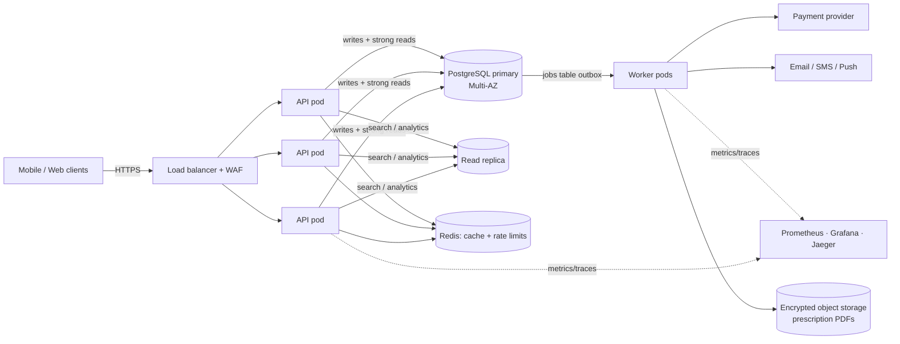
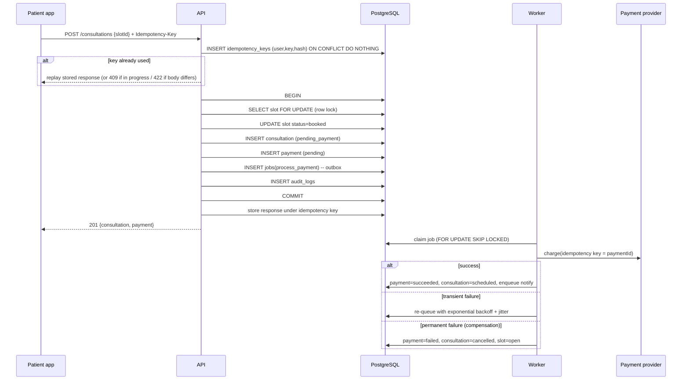

# Amrutam Telemedicine Backend — Architecture

## 1. Goals and constraints

| Requirement | Target | How it is met |
|---|---|---|
| Scale | 100k consultations/day (~1.2/s avg, ~15/s peak; ~10–20x that in reads) | Stateless API pods behind a load balancer + HPA, Postgres primary + read replica, cache-aside on search |
| Latency | p95 < 200 ms reads, < 500 ms writes | Indexed queries, 5 s statement timeout, connection pooling, cached search, heavy work moved to async jobs |
| Availability | 99.95% (≈22 min/month) | ≥3 API replicas across AZs, PodDisruptionBudget, Multi-AZ RDS, rolling deploys with readiness probes |
| Security | Encryption, MFA, RBAC | TLS, AES-256-GCM field encryption + KMS at rest, TOTP MFA, role guards + object-level checks |
| Observability | Metrics, logs, traces | Prometheus metrics + SLO alerts, structured pino logs with request IDs, OpenTelemetry traces → Jaeger |

## 2. High-level architecture and data flow



**Modular monolith.** The code is split into modules (`auth`, `doctors`, `consultations`, `admin`) with a service layer and routes per module. Dependencies (`db`, `cache`, `cipher`) are built once in `src/container.js` and injected into each service (constructor-style DI), so tests can swap them. Each module can later be extracted into its own service without changing its interface. A monolith was chosen over microservices because at this scale it gives lower latency, simpler transactions and fewer failure modes.

**Request path:** helmet headers → JSON body limit (100 kb) → request ID + structured log → metrics → per-IP rate limit → JWT auth → RBAC → zod validation → idempotency → service → Postgres.

## 3. Booking flow (sequence)



## 4. ER diagram

```mermaid
erDiagram
  users ||--|| profiles : has
  users ||--o| doctors : "is (role=doctor)"
  doctors ||--o{ availability_slots : publishes
  availability_slots ||--o| consultations : "booked by"
  users ||--o{ consultations : "patient"
  doctors ||--o{ consultations : "doctor"
  consultations ||--o{ prescriptions : produces
  consultations ||--|| payments : "paid by"
  users ||--o{ audit_logs : "actor"

  users { uuid id PK; text email UK; text password_hash; enum role; text mfa_secret_enc; bool mfa_enabled }
  profiles { uuid user_id PK,FK; text full_name; text phone; date dob }
  doctors { uuid id PK,FK; text specialization; int fee_cents; text[] languages; bool verified }
  availability_slots { uuid id PK; uuid doctor_id FK; timestamptz start_time; enum status; int version }
  consultations { uuid id PK; uuid patient_id FK; uuid doctor_id FK; uuid slot_id FK; enum status; text notes_enc }
  prescriptions { uuid id PK; uuid consultation_id FK; jsonb items; text advice }
  payments { uuid id PK; uuid consultation_id FK,UK; int amount_cents; enum status; text provider_ref }
  audit_logs { bigint id PK; timestamptz created_at PK; uuid actor_id; text action; text entity; jsonb metadata }
```

Supporting tables: `idempotency_keys` (user_id, key) and `jobs` (durable queue). Full DDL: `migrations/001_init.sql`.

## 5. API schema

REST, versioned under `/api/v1`. Full OpenAPI 3.0 spec: [`docs/openapi.yaml`](openapi.yaml). Errors use one shape: `{ "error": { "code", "message", "details?" } }`.

## 6. Retry and backoff strategies

| Where | Strategy |
|---|---|
| DB transactions (`db.tx`) | Retry up to 3x on serialization failure (`40001`) or deadlock (`40P01`), exponential backoff 25 ms·2ⁿ + jitter |
| Background jobs (worker) | Up to 5 attempts, delay = random(0, min(5 min, 1 s·2ⁿ)) ("full jitter"); then status `dead` (dead-letter queue) + alert |
| External calls (`lib/retry.js`) | Generic `retry()` with full jitter, max cap, and an `isRetryable` predicate (only retry 5xx/timeouts, never 4xx) |
| Clients | Must send `Idempotency-Key` on writes, so they can safely retry on timeouts/5xx |
| Permanent failures | Marked `permanent` → no retry; payment failures trigger saga compensation |

## 7. Data partitioning

* **audit_logs** is range-partitioned by month (`PARTITION BY RANGE (created_at)`). Old partitions are detached and archived to S3/Glacier (7-year medical retention) without expensive DELETEs. A monthly job (pg_partman in production) creates future partitions.
* **consultations / availability_slots** — at 100k/day (~36M/year) a single Postgres comfortably holds several years with the existing composite indexes. Next step when needed: monthly range partitioning on `created_at` / `start_time`.
* **Horizontal scale-out path:** shard by `doctor_id` hash (Citus) — slots, consultations and prescriptions for a doctor co-locate, so a booking stays a single-shard transaction.
* **Read/write split:** search and analytics go to the read replica; booking and anything needing read-your-writes goes to the primary.

## 8. Caching and concurrency handling

**Caching (cache-aside):** doctor search results (TTL 30 s) and admin analytics (TTL 60 s). Writes that change availability (`addSlots`, `book`, `verifyDoctor`) invalidate the `doctors:` prefix. The cache is an interface; the in-process version is used locally and Redis in production so every replica shares it. Clinical data (consultations, prescriptions) is never cached.

**Concurrency — preventing double booking (3 layers):**
1. **Pessimistic lock:** `SELECT … FOR UPDATE` on the slot row serialises concurrent bookers of the same slot; others see `status != open` → `409`.
2. **DB constraint:** partial unique index `uq_consultation_active_slot` on `consultations(slot_id) WHERE status <> 'cancelled'` — even a buggy code path cannot create two live bookings.
3. **Idempotency keys:** a retried request returns the original response rather than booking again.

The integration test fires 4 concurrent bookings at one slot and asserts exactly one `201` and three `409`s. State changes on consultations lock the row (`FOR UPDATE`) and are validated by an explicit state machine (`src/lib/stateMachine.js`). Background workers use `FOR UPDATE SKIP LOCKED` so many workers never pick the same job.

## 9. Transaction management and sagas

* Every multi-row change runs in one ACID transaction via `db.tx()`, and the **audit row is written in the same transaction** — no change without an audit record.
* **Transactional outbox:** jobs are inserted into the `jobs` table inside the business transaction, so a side effect (payment, notification, PDF) is queued if and only if the change committed. No dual-write problem.
* **Booking saga (orchestrated):**
  1. `book` (local tx): reserve slot → consultation `pending_payment` → payment `pending` → enqueue `process_payment`.
  2. `process_payment` (worker): charge provider with `paymentId` as provider idempotency key → mark `succeeded` + consultation `scheduled`.
  3. **Compensation** on permanent failure: payment `failed`, consultation `cancelled`, slot back to `open`.
  4. Cancellation of a paid consultation enqueues `refund_payment` (compensating action).
* Each handler is idempotent (checks current state first), so at-least-once delivery is safe.
* Roadmap: a sweeper (cron) to cancel consultations stuck in `pending_payment` for > 15 min.

## 10. Backup and disaster recovery

| | Target |
|---|---|
| RPO | ≤ 5 min (continuous WAL archiving / PITR) |
| RTO | ≤ 30 min (Multi-AZ failover ≈ 1–2 min; region restore ≤ 30 min) |

* **RDS Multi-AZ** synchronous standby; automatic failover on AZ loss.
* **Automated snapshots** (14-day retention) + **point-in-time recovery**; snapshots copied cross-region (ap-south-1 → ap-southeast-1) daily, encrypted with KMS.
* **Monthly restore drill:** restore latest snapshot to a scratch instance, run migrations + smoke tests, record actual RTO.
* Audit-log partitions archived to S3 with Object Lock (WORM) for tamper-proof retention.
* Infrastructure is code (`infra/terraform`, `infra/k8s`), so the stack can be rebuilt in a secondary region; container images are immutable and tagged by commit SHA.
* Runbook: promote cross-region replica → update DNS / secrets → scale API and workers → verify `/readyz` → replay dead-letter jobs.

## 11. Scalability numbers

* 100k consultations/day ≈ 1.2 writes/s average, ~15/s peak (10x evening peak). Each booking is ~6 statements in one tx → well under 10 ms on indexed tables.
* Reads (search, slots, list) ~20x writes → ~300 rps peak; cached search + read replica keep p95 well below 200 ms.
* API pods are stateless; HPA scales 3→20 on CPU. Postgres connections are bounded by pool size (20/pod); PgBouncer in front of RDS when pods > 20.
